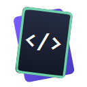
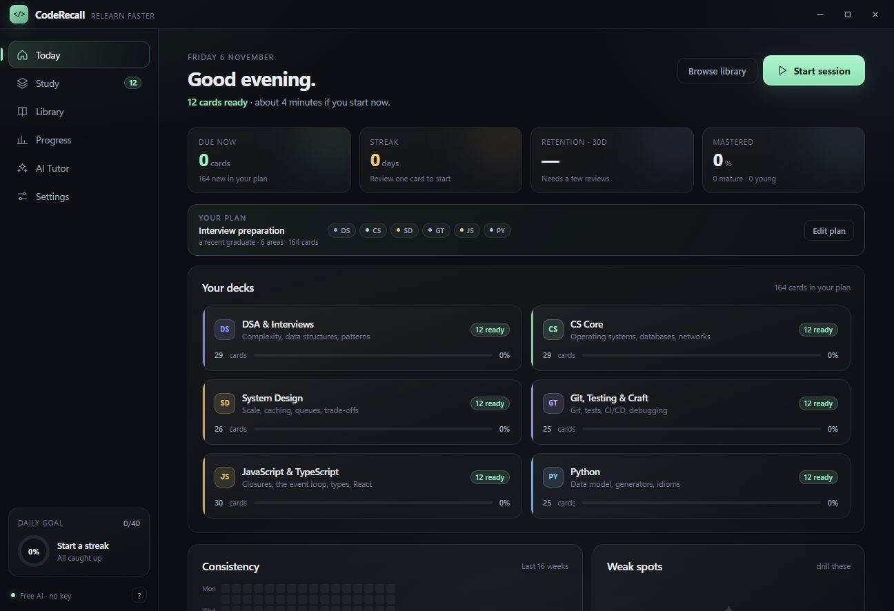
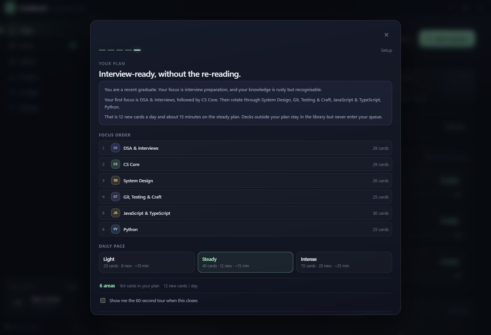
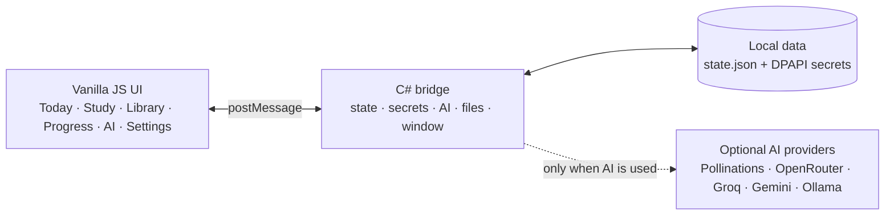

<div align="center">



# CodeRecall

**Relearn faster. Remember longer.**

Offline-first spaced repetition for software engineers returning to code.

[Download](#install) · [Features](#-highlights) · [How it works](#-how-it-works) · [Build from source](#-build-from-source) · [Contributing](CONTRIBUTING.md)

<br />

[](https://github.com/youssefsadquy/CodeRecall/actions/workflows/ci.yml)
[](https://github.com/youssefsadquy/CodeRecall/releases/latest)


</div>



<p align="center"><sub>Today shows only the decks in your plan, the cards ready now, and the next seven days.</sub></p>

## Why CodeRecall?

Relearning is not the same as learning for the first time. A 214-card library is useful; a 214-card wall on day one is not. CodeRecall asks five quick questions, builds a focused plan, and keeps every other deck in the library without letting it flood your queue.

- **A plan, not a library dump.** Today, Study, Progress, weak spots and forecasts all respect the active plan.
- **Only relevant cards surface.** Hide JavaScript if you are a Python engineer. Hide DSA if you are refreshing a stack.
- **Nothing is deleted.** Hidden decks remain searchable, selectable and keep their scheduling history.
- **No account. No cloud. No telemetry.** Progress is local JSON on your machine.
- **AI is optional.** The free tutor works without a key; the app remains fully usable with AI off.

## ✨ Highlights

| | Feature | What it does |
|:--:|---|---|
| 🎯 | **Personal plan** | Background, freshness, goal, interests and pace produce a focused deck set with an explainable written analysis. |
| 🧭 | **Guided tour** | A seven-step spotlight tour covers Today, Study, Library, Progress, the AI tutor and Settings. |
| 🧠 | **214 hand-written cards** | Eight areas: JavaScript/TypeScript, Python, Java/C#, CS core, DSA, system design, web, and Git/testing/craft. |
| 🔁 | **SM-2-flavoured scheduling** | Again/Hard/Good/Easy, lapses, ease clamping, daily new-card limits, and cram sessions that leave the schedule alone. |
| 📊 | **Plan-aware analytics** | Accuracy, maturity, 14-day activity, a 16-week heatmap, forecast, and the topics that keep slipping. |
| 🔎 | **Fast searchable library** | Search your plan by default or switch to the full library. Built-in cards are read-only; duplicate to edit. |
| 🤖 | **Free AI tutor** | Explain a card, generate cards, or get quizzed. The tutor receives your background and active areas. |
| 🔐 | **Local-first data** | JSON state, DPAPI-encrypted API keys, export/import backups, and one-click reset. |
| ⌨️ | **Keyboard-first** | `Space` reveals, `1`–`4` grade, `Ctrl+K` searches, `?` opens every shortcut. |

## 🖼️ Screenshots

<table>
<tr>
<td width="50%">

<p align="center"><sub>Five questions produce a focus order, card count and daily pace.</sub></p>
</td>
<td width="50%">

<p align="center"><sub>Small, dependency-free, and built to run offline.</sub></p>
</td>
</tr>
</table>

## ⚙️ How it works



The UI is plain HTML, CSS and JavaScript rendered inside a single WebView2 control. A small C# host handles the window chrome, local files, DPAPI secrets and provider calls. There is no bundler, framework or Node runtime requirement for the shipped app.

## 🧩 Personal plan

The wizard asks about:

1. **Background** — studying, recent graduate, returning after a break, working engineer, or self-taught.
2. **Freshness** — mostly gone, rusty, or mostly current.
3. **Goal** — interviews, fundamentals, a new role/stack, depth, or a daily habit.
4. **Interests** — the areas you actually care about.
5. **Pace** — light, steady or intense.

A small weighted model scores the eight decks locally. No AI, no network, no opaque ranking. You see the recommended focus order and can change it before saving. Editing the plan later never deletes progress.

## 🛠️ Tech stack

| Layer | Technology |
| --- | --- |
| **Desktop host** | C# 10 · .NET 6 · Windows Forms · WebView2 |
| **Interface** | Vanilla JavaScript · HTML5 · CSS3 |
| **Scheduling** | SM-2-flavoured spaced repetition |
| **Storage** | JSON at `%LOCALAPPDATA%\CodeRecall` · Windows DPAPI for keys |
| **AI** | OpenAI-compatible providers, including a keyless free endpoint and local Ollama |
| **Release** | Self-contained single-file Windows executable |

### Language mix

| Language | Files | Lines | Share | Role |
| --- | ---: | ---: | ---: | --- |
| JavaScript | 18 | 5,480 | 79% | UI modules, scheduler, statistics, 214 cards |
| CSS | 1 | 773 | 11% | Design system and responsive layout |
| C# | 5 | 619 | 9% | Window host, bridge, AI client, storage |
| HTML | 1 | 98 | 1% | App shell |

<sub>Approximate source lines, excluding build output and documentation.</sub>

## 📦 Install

1. Download `CodeRecall.exe` from the [latest release](../../releases/latest).
2. Run it. There is no installer — it is a single self-contained executable.
3. Windows may show a SmartScreen warning because the build is unsigned. Choose **More info → Run anyway**.

**Requirements**

- Windows 10 or 11, x64.
- Microsoft Edge WebView2 runtime. Windows 11 and recent Windows 10 installs include it; otherwise install the [Evergreen WebView2 runtime](https://developer.microsoft.com/microsoft-edge/webview2/).

Progress lives at `%LOCALAPPDATA%\CodeRecall\state.json`. Use **Settings → Export backup** before moving machines.

## 🧠 Study loop

1. Open **Today** and press **Start session**, or build a custom session in **Study**.
2. Read the question and answer it out loud before revealing.
3. Grade it **Again**, **Hard**, **Good** or **Easy**.

Modes include due + new, due only, new only, weak spots and cram. A light plan starts at 8 new cards/day, steady at 12, intense at 20. The daily goal scales with it, and reviews never pile up.

## 📚 Card library

| Area | Cards | Focus |
| --- | ---: | --- |
| JavaScript & TypeScript | 30 | closures, event loop, types, React |
| Python | 25 | data model, generators, idioms |
| Java & C# | 24 | OOP, generics, collections, GC, async |
| CS Core | 29 | operating systems, databases, networks, HTTP |
| DSA & Interviews | 29 | complexity, data structures, patterns |
| System Design | 26 | scale, caching, queues, trade-offs |
| Full-stack & Web | 26 | HTTP, APIs, auth, security, React |
| Git, Testing & Craft | 25 | Git, tests, CI/CD, debugging |

Built-in cards are read-only. **Duplicate & edit** creates a personal copy; new cards can be added manually or generated with the AI tutor.

## 🤖 AI tutor

The default provider is **Free AI — no key**, using a public Pollinations endpoint. It works out of the box, can be rate-limited at busy times, and needs an internet connection.

The rest of the app works with AI set to **Offline only**. Optional providers:

- OpenRouter (including free models)
- Groq
- Google Gemini
- Ollama (fully local)
- Any OpenAI-compatible endpoint

The tutor receives your background, freshness and active areas, so explanations fit the plan instead of assuming a generic computer-science graduate. API keys are encrypted with Windows DPAPI and are never written to `state.json`.

## 🔐 Your data

- Progress, settings and custom cards: `%LOCALAPPDATA%\CodeRecall\state.json`
- Encrypted API keys: `%LOCALAPPDATA%\CodeRecall\secrets.dat`
- No telemetry or analytics requests.
- Network access happens only when the AI tutor is used or a remote provider is configured.
- **Settings → Export backup** writes a portable JSON file.
- **Settings → Reset progress** clears scheduling and history while keeping settings and custom cards.

## 🚀 Build from source

**Prerequisites:** Windows, the [.NET 6 SDK](https://dotnet.microsoft.com/download/dotnet/6.0) or newer, and the WebView2 runtime. Node.js is only needed for the browser preview and JavaScript syntax checks.

```powershell
git clone https://github.com/youssefsadquy/CodeRecall.git
cd CodeRecall
.\scripts\build.ps1
```

The script publishes a self-contained single file to `publish\CodeRecall.exe`.

Manual publish:

```powershell
dotnet publish CodeRecall.csproj -c Release -r win-x64 --self-contained true `
  -p:PublishSingleFile=true -p:IncludeNativeLibrariesForSelfExtract=true `
  -p:EnableCompressionInSingleFile=true -o publish
```

### UI-only preview

```powershell
node scripts\serve.js
```

Open <http://localhost:8765>. The preview uses a mock bridge, so AI calls return canned text, but every screen, the setup wizard and the tour work.

## 🗂️ Project layout

```text
CodeRecall/
├─ assets/
│  ├─ core.js          state, bridge, scheduler, stats, personalisation
│  ├─ ui-profile.js    setup wizard and guided tour
│  ├─ ui-today.js      Today dashboard
│  ├─ ui-study.js      session setup and review loop
│  ├─ ui-library.js    search, card viewer, editor
│  ├─ ui-stats.js      progress analytics
│  ├─ ui-ai.js         AI tutor
│  ├─ ui-settings.js   settings, plan, backups
│  ├─ data-*.js        deck definitions and 214 cards
│  ├─ index.html
│  └─ styles.css
├─ MainForm.cs         borderless WebView2 host
├─ Bridge.cs           JS ↔ C# commands
├─ AiClient.cs         provider calls and retries
├─ scripts/            preview server and build helper
└─ .github/workflows/  CI and tagged Windows releases
```

## 🗺️ Roadmap

- [ ] Expand the automated checks and add regression tests for the scheduler and plan model.
- [ ] Accessibility pass for the tour, modal focus trapping and screen-reader labels.
- [ ] Stricter schema validation for imported backups.
- [ ] Optional card packs and a read-only deck import format.
- [ ] More coverage for SQL and cloud fundamentals.

## 🤝 Contributing

Bug reports, card corrections and focused pull requests are welcome. Read [CONTRIBUTING.md](CONTRIBUTING.md) first, and see [CHANGELOG.md](CHANGELOG.md) for what changed.

Please do not open a public issue for a security problem. Follow [SECURITY.md](SECURITY.md) instead.

## 📄 License

[MIT](LICENSE) © 2026 CodeRecall contributors

CodeRecall is an independent project. Microsoft, WebView2 and the names of the optional AI providers are trademarks of their respective owners.

<div align="center"><sub>Built with C#, vanilla JavaScript and a deliberate lack of dependencies.</sub></div>
